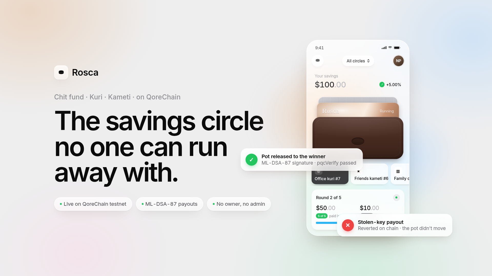

# Rosca

**The savings circle the organiser can't run away with.**

> Built for QoreChain [Build Before Q-Day](https://build.qorechain.io), category **Post-Quantum dApp**.
> Deadline: 2 December 2026, 23:59 UTC (3 December, 05:29 IST). Testnet only (`qorechain-diana`, EVM chain id 9800).
>
> **App:** https://app.rosca.exprmnts.fun · **Site:** https://rosca.exprmnts.fun ([how it works](https://rosca.exprmnts.fun/how) · [live](https://rosca.exprmnts.fun/live) · [security](https://rosca.exprmnts.fun/security) · [proof](https://rosca.exprmnts.fun/proof))

## For the judges: requirements and where to check them

| Requirement | Where it is | How to check it |
| --- | --- | --- |
| **Scoped EVM window** | Every member's window is opened with `allowedTargets` = its circle and fUSD only, signed hybrid (secp256k1 + ML-DSA-87): [`web-src/lib/actions.ts`](web-src/lib/actions.ts) (`ensureWindow`), [`scripts/lib/evm.ts`](scripts/lib/evm.ts) | A real [window opened on chain](https://rosca.exprmnts.fun/tx/EB18C117114DE90F54D99C9249AFFA4A4D061BDA85EF0E0ACFF17BDB2DB60574): scoped to one circle and fUSD, 20 transactions, 3,000 blocks; every call in [`docs/PROOF.md`](docs/PROOF.md) went through such a window |
| **`pqcVerify`** | [`src/libraries/PqcGate.sol`](src/libraries/PqcGate.sol) (`requireSignedBy`), called by `RoscaCircle.release`; the key comes from `pqcKeyStatus` (ML-DSA-87, proof of possession) | A real [ML-DSA-87 payout](https://rosca.exprmnts.fun/tx/0x68d8f0fbc11f8d18fe5001558b7eebe158c8e9d46db8f6b063087e83b0cadbea) and a [stolen-key payout that reverted](https://rosca.exprmnts.fun/tx/0x703be9e1d1178d89b97bab28c1ae29ce33377ddcfe8b7a5e72b589eae2d0f660) |
| **Two-stage QCAI audit** | [`audit/`](audit/): both reports, every finding answered | Before fixes 72/100 (high); after fixes **78/100, medium, rated quantum-safe** |
| **Foundry tests** | [`test/`](test/): 67 unit, fuzz and invariant tests (money conserved over 128,000 random actions) | `forge test` |
| Public repo, MIT | [`LICENSE`](LICENSE) | |
| README and cover | this file, [`media/cover.png`](media/cover.png) | |
| Video, 3 minutes at most | on the [project page](https://build.qorechain.io/p/rosca) and the site's "Watch demo" | |
| Testnet addresses | [below](#testnet-addresses) | |
| Kits credited | [Kits used](#kits-used) | verified on the project page (3 of 3) |
| AI-Native | [`AI_USAGE.md`](AI_USAGE.md) | |
| Threat model | [`docs/THREAT_MODEL.md`](docs/THREAT_MODEL.md): 17 threats, each mapped to a test | |

## What a rosca is

A **rosca** (rotating savings and credit association) is a group of people who each pay the same amount into a pot
every month. Each month one member takes the whole pot, until everyone has had a turn.

It is one of the oldest ways people save, and it goes by many names:

| Where | Name |
| --- | --- |
| India (legal term, Chit Funds Act 1982) | **chit fund** |
| Kerala | **kuri**, chitty |
| Tamil Nadu | seettu |
| Andhra Pradesh, Telangana | chitti |
| North India | **committee**, kameti |
| Maharashtra | bhishi |
| West Africa | ajo, esusu, susu |
| Mexico | tanda |
| China | hui |
| Indonesia | arisan |
| Korea | kye |
| Philippines | paluwagan |

## The problem

Someone has to hold the pot. In a chit fund or a kuri that is the organiser, and the classic fraud is simple:
the organiser takes the pot and disappears. Moving the circle on-chain does not fix this if one key can still move
the money, and a key that is safe today can be broken by a quantum computer tomorrow.

## What Rosca does

- Members pay their monthly share into a pot that **no single key can move**, not even the organiser's.
- Each month the members bid the discount they accept. The highest discount wins, as in a real chit fund auction, and the discount is shared out.
- Paying out needs the winner's **ML-DSA-87** (post-quantum) signature, checked on chain with `pqcVerify`, and a majority of members.
- A leaked classical (ECDSA) key alone can move nothing.

## The app

[app.rosca.exprmnts.fun](https://app.rosca.exprmnts.fun) is an installable web app (PWA) with two modes, switched in the top bar.

**Live** (the default) is the real product on the QoreChain testnet:

1. **Create my wallet.** Keys are made on the device: secp256k1 for everyday transactions and ML-DSA-87 for payouts.
   The user funds it from the [QoreChain faucet](https://dashboard.qorechain.io/faucet), registers the ML-DSA-87 key
   with proof of possession, and moves the faucet's fUSD into the wallet (`MsgConvertCoin`, signed by the user).
2. **Create a circle** and set its terms: name, amount per member, members (2 to 12), how often (daily, weekly,
   monthly by default; 5-minute and hourly rounds for testing), the biggest discount a bidder can take (up to 40%) and
   the organiser fee (up to 5%, taken only from discounts).
3. **Invite friends** with a link. Each friend makes a wallet, funds it and joins with their own post-quantum key.
4. **Play every round** from one "next step" card: pay, bid a discount, close the auction, approve, then the winner
   **signs and collects** with ML-DSA-87. Every action opens a confirm sheet like a wallet does, and the circle is
   drawn as a ring with coins moving as members pay.

**Demo** is a guided version: Rosca's faucet funds the wallet and two bots, Ravi and Meera, play a 3-person circle with
2-minute rounds, so anyone can see a full round in about five minutes. Demo also lets you **play the thief**: send the
pot to a stranger with your own real signature, and watch it revert on chain.

How it works, who can move the pot, your keys, the recovery phrase and the proof links live behind the profile button.

All signing happens on the device. The QoreChain REST API sends no CORS headers, so the app's Vercel project rewrites
`/api/rest/*` to it; the rewrite only forwards already-signed transactions. Build with `npm run build:app` (esbuild), deploy `web-app/`.
The site (`web/`) is plain HTML and CSS.

## The live circle

`scripts/keeper.ts` runs as a service and plays five demo members in one circle after another, one round an hour, so the
home page always shows a live round. Once per circle it also plays a thief with a stolen classical key; every attempt
reverts on chain. See [`docs/PROOF.md`](docs/PROOF.md).

## Testnet addresses

`qorechain-diana`, EVM chain id 9800. Transaction links open `rosca.exprmnts.fun/tx/<hash>`, which reads the
transaction straight from the testnet RPC and decodes it. The public [QoreChain Explorer](https://explore.qore.network)
opens on mainnet (choose **Testnet** at the top) and lists EVM transactions under their Cosmos hash; each `/tx` page links
to it with that hash.

| What | Address |
| --- | --- |
| RoscaFactory v3 (new circles open here) | [`0x8197d7a6345b0b087976e5412629514719ccbd2f`](https://explore.qore.network/address/0x8197d7a6345b0b087976e5412629514719ccbd2f) |
| RoscaFactory v2, v1 (their circles still play) | [`0x29053772…afef`](https://explore.qore.network/address/0x29053772f08c30c682e0fbb5db3a3d86ac84afef), [`0x366d6a02…7d39`](https://explore.qore.network/address/0x366d6a029d94a98ba4d93e2eb4dbf07720387d39) |
| fUSD (the fest's test dollar) | [`0x97143B771D34ddb9130b807b135Ae675A5a963CA`](https://explore.qore.network/address/0x97143B771D34ddb9130b807b135Ae675A5a963CA) |
| Organiser and deployer (the keeper) | `qor1pmzz6uld3gud6etn609pqgff2fnjlzswutxqyu` · `0x0eC42D73eD8a38DD6573d3ca10212952672F8A0e` |
| Demo members | `qor1x5dahtmw7aa6vt5mgzeumlzgud7j0d8qnl4wr0`, `qor1yjl4gudedu3n7hv6fmxtmuk940g2nd7s9wrxd6`, `qor192vyu5t8walfqu665quhstkphslj394703mz4m` and two more ([`docs/PROOF.md`](docs/PROOF.md)) |
| Team wallet (QoreX) | `qor1xnadc6s9tne0f87lrwsw55ld432npqrtf5yxe2` |

## Security and AI

- [`docs/THREAT_MODEL.md`](docs/THREAT_MODEL.md): who might attack, what stops each attack, and the risk that is left.
- [`docs/PROOF.md`](docs/PROOF.md): every claim as a testnet transaction.
- [`AI_USAGE.md`](AI_USAGE.md): how an AI coding agent built Rosca, what the humans did, and how the work was checked.
- [`audit/`](audit/): the two-stage QCAI audit. Stage 1 (before fixes): 72/100, high risk, 6 findings, each fixed
  or answered. Stage 2 (after fixes, QoreChain setting): **78/100, medium risk, rated quantum-safe**; every finding is
  answered there with the code and test that already covers it. The audit covers the contract source, so it applies to any network the same code is
  deployed on.

## Kits used

| Kit | Where |
| --- | --- |
| [`create-qorechain-dapp`](https://www.npmjs.com/package/create-qorechain-dapp) 0.14.0, `foundry` template | project skeleton, EVM window helper (`scripts/window.ts`) |
| [`@qorechain/sdk`](https://www.npmjs.com/package/@qorechain/sdk), [`@qorechain/evm`](https://www.npmjs.com/package/@qorechain/evm) | EVM window, PQC key registration |
| [Foundry](https://getfoundry.sh) | contracts and tests |

The original template README is kept as `TEMPLATE-README.md`.

## Team

Nikhil P N and Hina Hanan (ideas and product direction).

## Licence

MIT
